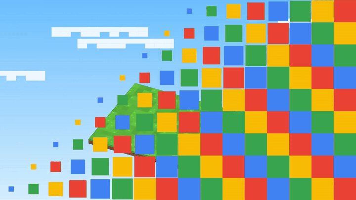

# Codeville (Windows app)

[](promo/launch.mp4)

**Built for vibe coders: your prompts, made visual.** Watch the [narrated launch film](promo/launch.mp4) (58 s), the
[15-second social cut](promo/social.mp4) or the [narrated demo of the real app](promo/demo.mp4), or see the
[launch site](https://dharaneechinnu.github.io/codeville/) (source in `site/`). [Download for Windows](https://github.com/dharaneechinnu/codeville/releases).

A desktop workspace for vibe coding. It shows what your coding agent builds: a block town (one building per feature, one
block per file), a walking shopper that runs your tests, and short messages that say what broke and what to do next.

## What is in the window

| Widget | What it does |
|---|---|
| Chat | Type a prompt and send it to Claude Code. Shows what the agent did: edits, tools, sub-agents. |
| Visualizer | **Build**: the 3D town; click a block to see the file and open it. **Test**: a shopper walks the test steps and stops at the one that fails. Rotate, zoom and reset in both. |
| Files | The project by feature or by folder, with git badges. |
| Source control | Stage, commit, commit and push, push. Failures say what broke and the next step. |

Also: **Terminal** and **Editor** popups (drag and resize them), **Extensions** (Claude Code connection, git), and
**Adjust layout** to drag widgets, resize them with the bars, or pick a preset. The layout is remembered.

First run: the welcome screen checks Git, Claude Code and Node.js, helps you connect your agent, and lets you open a
folder, start a new project from a template (Empty, Node, Python) or copy a repository.

## Parts

| Part | What it is |
|---|---|
| `src/main`, `src/renderer` | The Windows app: Electron, React and three.js. |
| `backend/` | The backend: Django and Django REST Framework, SQLite, served by waitress on `127.0.0.1`. |
| `plugin/code-visualizer` | The Claude Code plugin. It forwards hook events to the backend. |
| `scripts/prepare-python.mjs` | Builds the Python that ships inside the installer. |

The backend holds everything that is not drawing: the event stream (`/stream`), the parsers for test, lint, type and
build output, the project analyzer, the command runner, git actions, project templates and the agent tools.

## Run it

```
cd backend
py -3.12 -m venv .venv
.venv\Scripts\python -m pip install -r requirements.txt
cd ..
npm install
npm start          # builds, then opens the window; the window starts the backend for you
```

Tests: `npm test` (68 Python tests). Type check: `npm run typecheck`.

For UI work: `npm run backend` in one terminal, `npm run dev:ui` in another, then open
`http://localhost:5180/#base=http://127.0.0.1:<port>&token=<token>` (port and token are in `~/.code-visualizer/config.json`).

## Build the installer

```
npm run dist       # release\Codeville-Setup-<version>.exe
npm run dist:dir   # unpacked app only, faster for testing: release\win-unpacked
```

The first run downloads the official Python 3.12 "embeddable" zip from python.org into `build/python` and installs the
backend packages from `backend/requirements-runtime.txt`. The installer then needs no Python on the user's computer. It
also bundles the Claude Code plugin. The app icon is `resources/icon.png`. The installer is not code signed yet, so
Windows SmartScreen will warn (More info, then Run anyway).

## Release

Releases are built on GitHub, on a Windows runner, by `.github/workflows/release.yml`:

```
git tag v0.2.0
git push origin v0.2.0
```

The workflow sets the app version from the tag, runs the backend tests, the type check and the gesture tests, builds the
installer, and publishes a GitHub Release with `Codeville-Setup-<version>.exe`, `Codeville-Setup.exe` and
`SHA256SUMS.txt`. The fixed name keeps this link on the newest release, which the launch site's Download buttons use:
https://github.com/dharaneechinnu/codeville/releases/latest/download/Codeville-Setup.exe

To build the installer without releasing, run the Release workflow by hand from the Actions tab; the installer is kept
with the run for 14 days.

## Project analysis agent

When you import a project, an analysis agent (`backend/visualizer/analysis`) runs six tools in order and reports each
step live (`analysis.step` events): `scan_files`, `read_identity`, `detect_stack`, `classify_layers`, `find_features`
and `summarize`. The report says what the project is (from its README), its frontend, backend, database and outside
services (from package files, `.env` examples and docker-compose), how many files are in each layer, and its features.
It then traces how the buildings connect (`find_connections`): imports between files, frontend calls matched to the
backend routes they hit, files that talk to the database, and files that use an outside service. The town draws these
as links with small packets moving along them (Links: main, all or off); click a building to see only its links.
It also finds the project's own test, lint, type check and build commands and the folder each runs in (`find_commands`:
for example pytest from `backend`, `npm run build` from `frontend`), and lists the test cases written in the test files
(`find_tests`). The Test view builds its play buttons from these and shows the cases before a run. When a run stops
before any test starts, the message says the real reason (no package.json, missing package, database not reachable).
A feature groups the files about the same thing across layers, for example `matters.py`, `MatterList.tsx` and
`test_matters.py`. The town gives each feature its own district with a separate building per layer, colors blocks by layer, shows the database as its own building and each outside service as a
small block. The same tools are available to agents as `analyze_project`, `detect_stack`, `find_features`, `find_connections`, `find_commands` and `find_tests`.

## Connect Claude Code

The welcome screen and **Extensions** show the exact commands. In Claude Code:

```
/plugin marketplace add <path to the plugin folder>
/plugin install code-visualizer@code-visualizer
```

The plugin reads `~/.code-visualizer/config.json` (port and token) that the app writes when it starts.

## Agent tools

Any agent can call these over HTTP with the token in the `x-cv-token` header.

| Tool | What it does |
|---|---|
| `project_map` | Features and the files in each. |
| `analyze_project` | The full analysis report: what the project is, its stack, layers and features. |
| `detect_stack` | Frameworks, database and outside services. |
| `find_features` | Features with their frontend, backend and test file counts. |
| `find_connections` | How the parts connect: calls, imports, database use, outside services, tests. |
| `recent_events` | The latest events, optionally filtered by type. |
| `current_problems` | The newest failing test, lint, type or build run: what broke, where, what is next. |
| `run_check` | Runs the project's own test, lint, type check or build and returns the same crisp result. |
| `git_status` | Branch, staged and changed files, ahead and behind. |

`GET /api/tools` lists them with their JSON schemas. `POST /api/tools/<name>` calls one.

## Backend API

| Endpoint | Use |
|---|---|
| `GET /health` | Is it running (no token). |
| `GET /stream` | Server-sent events: agent, test, build and git events plus terminal output. |
| `POST /hook/claude-code` | Where the plugin sends hook events. |
| `POST /api/analyze`, `/api/file` | Read a project into features and files; read one file. |
| `POST /api/run`, `/api/stop` | Run or stop a command. |
| `POST /api/git/changes`, `/stage`, `/commit`, `/push` | Source control. |
| `POST /api/agent/send` | Send a prompt to Claude Code. |
| `GET /api/project/templates`, `POST /api/project/new`, `/clone` | Start a project. |
| `GET /api/doctor` | First-run checks for Git, Claude Code and Node.js. |

Errors come back as `{"error": "..."}`, and for git and project actions also as a `problem`: what broke, why, the file and
line if any, and what to do next.

## Hand control (hologram)

The hand icon in the Build view's toolbar turns on the camera and switches the town to a hologram look: see-through
buildings with glowing outlines, and a live tracker drawn over them (`src/renderer/handview.ts`): the hand's skeleton,
fingertip rings, a palm reticle and a mark for the gesture it recognises. Only the hand is drawn; the camera picture is
never shown. Hands are tracked by Google's MediaPipe Hand
Landmarker (Apache 2.0). The runtime and the model are bundled and run on this computer, so no camera picture leaves it.

| Gesture | What it does |
|---|---|
| Open palm, moved around | Turns and tilts the town |
| Two open hands, moved apart or together | Zoom in or out |
| Fist | Hold still, nothing moves |
| Two quick pinches (thumb and finger) | Reset the view |

`npm run prepare:gestures` copies the runtime and downloads the model (about 8 MB) once; `dev:ui` and `build:ui` run it.
`npm run test:gestures` checks the gesture rules with made-up hand points. If the camera is blocked, turn it on in Windows
Settings, Privacy and security, Camera, for desktop apps. The window is now served from `app://codeville` instead of a file.

## Launch site

`site/` is the launch website: what Codeville does, a screenshot of the real app with its parts labelled, one section
per feature with a short silent loop cut from the real-app recording (`site/media/clip-*.mp4`), install steps,
requirements and an FAQ. The `Launch site` workflow (`.github/workflows/pages.yml`) publishes it to GitHub Pages on
every push to `main` that changes `site/`. Open `site/index.html` to preview it locally. The films in `promo/` are for
social posts and talks and are not on the site.

## Promo videos

`promo/` holds the narrated launch film (58 s), a 15 s social cut, the narrated demo (2:14), the launch page and the code that makes them. Both videos show
the **real app**: the React and three.js UI talking to the real Django backend, opening a real sample project, running
its real tests and pushing to a real git remote, recorded in Chromium. Two inputs are scripted for the recording, and the
videos say so on screen: the agent (`promo/capture/bin/claude` stands in for `claude -p`; it writes real files and sends
the same hook events as the Codeville plugin) and the hands (`promo/capture/hands.js` feeds hand points to the app's own
gesture code in place of the camera model). The titles, captions, end card and music are drawn and synthesized in
`promo/render`; the narration is spoken by [Kokoro-82M](https://github.com/thewh1teagle/kokoro-onnx), an open-source
(Apache 2.0) text-to-speech model.

To record and build again (Linux or macOS, with the backend's venv set up):

```
python promo/capture/make_shop.py ~/work                       # the sample project and its git remote
# start the backend with promo/capture/bin and a venv that has pytest on its PATH, and the UI: npm run dev:ui
CV_HOME=~/.code-visualizer node promo/capture/record.mjs <rec dir> ~/work/shop-app   # needs <rec dir>/camera.y4m
python promo/capture/frames_to_mp4.py <rec dir>                # the raw recording at 30 fps
python promo/capture/compose.py <rec dir>                      # the edit, zooms and timeline
cd promo/render
python voice.py --script real_voice.json --out ../audio/real-voice.wav
node music.mjs
node render.mjs real --out real-frame.mp4 && python ../capture/mux.py <rec dir> real-frame.mp4 ../demo.mp4
node render.mjs launch --out launch-frame.mp4 && python ../capture/mux.py <rec dir> launch-frame.mp4 ../launch.mp4 launch
```

Open `promo/render/frame.html?scene=launch` (or `real`) in a browser to preview the overlay layer in real time.

The pro cuts (`launch.mp4`, `social.mp4`, `demo.mp4`) are built by `promo/render/pro.js` from the same recording:
`python promo/capture/shots.py <rec dir> <shots dir>` extracts the shots listed in `pro_timeline.js`, then
`node render.mjs pro-launch --shots <shots dir> --out ../launch.mp4` (and `pro-social`), and for the demo
`node render.mjs pro-demo --out pro-demo-frame.mp4 && python ../capture/mux.py <rec dir> pro-demo-frame.mp4 ../demo.mp4 pro`.
`node music_pro.mjs` writes their soundtracks; their voiceover lines are in `pro_voice.json`.

The narrated launch film (hook, why, what, five moments when you use it, close) is planned from its script by
`promo/capture/film_plan.py`: it speaks each line with Kokoro (voice `af_heart`), sizes every scene to its narration,
and writes `promo/render/film_timeline.js`, the voice track, `site/media/launch.vtt` and the recorded shots. Then
`node music_pro.mjs` and `node render.mjs pro-film --shots <shots dir> --out ../launch.mp4` (`film.js` draws it, captions
burned in). `voice.py --vtt` writes the demo's and social cut's caption files the same way.

## Not done yet

Per-feature test steps drawn as the shopper's route (login, cart, payment, admin), code signing, an app icon, and
auto-update.

## Security

The backend listens on this computer only. Every call except `/health` needs the token; the Host must be local and the
Origin must be the app or a local dev page. `run_check` only runs a command that matches the kind you ask for. Pushing
uses the git login already on the computer; the app stores no credentials.
